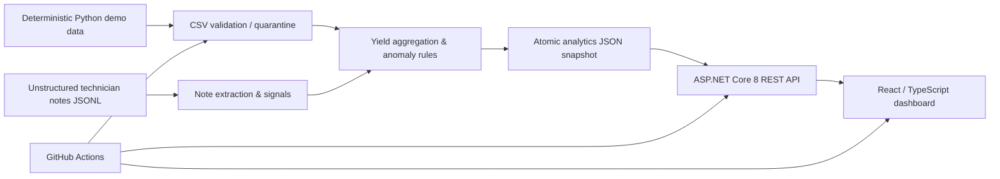

# FabYield Insights — Manufacturing Data Platform

[](https://github.com/mohamedtah22/embedded-systems-runtime/actions/workflows/fabyield-insights-ci.yml)

**A full-stack engineering analytics lab built with C# / ASP.NET Core 8, Python, React / TypeScript, Docker Compose, and CI.** It processes synthetic semiconductor-manufacturing telemetry, quantifies yield loss by wafer, production lot and equipment, detects anomalies, and exposes interactive drill-downs.

> **Portfolio disclaimer:** All wafer readings and technician notes are **deterministically synthesized for demonstration**. This is not connected to Intel or any real factory; none of the data, equipment IDs, alerts or performance statistics represents Intel production or operations. No employment at Intel or exposure to its internal systems is implied.

## Why this project exists

The goal is to demonstrate relevant engineering abilities for application-development student roles in manufacturing analytics: object-oriented C#, Python data pipelines, robust validation, structured + unstructured data, frontend/backend collaboration, container deployment, automated regression tests and troubleshooting. The sample analytic method is intentionally explainable and **not** a physical process-control or production fault-diagnosis algorithm.

## Engineering workflow



**Why a snapshot?** The Python batch pipeline publishes a versioned, atomic JSON artifact. The .NET web API only serves validated snapshots, avoiding a partly-written read. The boundary allows independent testing of ETL and backend code. A real factory-scale implementation would use a database, an event queue, authentication, and data-governance controls instead.

## Run the complete stack

Requirements: Docker Engine with Docker Compose plugin. No physical devices, company credentials, real manufacturing data or paid cloud accounts.

```bash
# From THIS project directory
# (inside embedded-systems-runtime/projects/fabyield-insights/)
docker compose up --build -d
# UI: http://127.0.0.1:8088
# API: http://127.0.0.1:8088/api/summary
# Health: http://127.0.0.1:8088/api/health

docker compose down --volumes
```

`etl` (Python) deterministically generates and processes demo data in a shared Docker volume, `api` (ASP.NET Core) reads it, and `dashboard` (React built into Nginx) serves the UI and proxies API requests. Docker Compose waits for ETL to complete successfully before the API starts.

## Local development without Docker

```bash
# In terminal 1: Python 3.10+ with no third-party dependencies
python3 -m unittest discover -s pipeline/tests -v
python3 pipeline/generate_demo.py --output data/events.csv --notes data/notes.jsonl --lots 50
python3 pipeline/transform.py --input data/events.csv --notes data/notes.jsonl --output data/snapshot.json

# In terminal 2: .NET SDK 8+
SNAPSHOT_PATH="$PWD/data/snapshot.json" dotnet run --project backend/FabYield.Api --urls http://127.0.0.1:8080

# In terminal 3: Node.js 20+
cd frontend
npm install --no-audit --no-fund
npm run dev
# Open http://127.0.0.1:5173
```

The dashboard offers **summary KPIs**, daily-yield chart, equipment comparisons, lot search/filter, ranked lot table, and exception/technician-note feed.

## What it tests

- Streaming CSV ingestion with required-field / numeric / time-zone / physical-bound validation.
- Duplicate rejection and row-level quarantine without losing valid observations.
- **Correct weighted yield** (`sum(passed dies) / sum(tested dies)`, not mean of wafer percentages).
- Per-tool/lot/day yield and explainable demonstration alerts below a synthetic **93% threshold**.
- Safe JSONL parsing for unstructured maintenance notes, keyword flags clearly labeled non-causal.
- Deterministic seeded generator; unit tests on malformed data, duplicate IDs, unknown notes, empty source, and atomic overwrite.
- ASP.NET API smoke tests against a **real running process** including health, pagination, tool filters, invalid parameters, and status endpoints.
- React TypeScript build, Docker Compose multi-service smoke test, and GitHub Actions.

> Automated tests are not a guarantee of production suitability. See [test plan](docs/TEST_PLAN.md) for assumptions and explicit exclusions.

## API endpoints

| Method | Endpoint | Description |
|---|---|---|
| GET | `/api/health` | Snapshot readiness / 503 when absent |
| GET | `/api/summary` | Weighted yield KPIs and source quality metadata |
| GET | `/api/lots?page=1&pageSize=20&tool=ETCH-02&minYield=85` | Validated filters and bounded pagination |
| GET | `/api/tools` | Equipment-level yield and throughput counts |
| GET | `/api/trend` | Yield over time |
| GET | `/api/alerts?severity=high` | Demo yield threshold alerts |
| GET | `/api/notes?flagged=true` | Extracted unstructured note signals |
| GET | `/api/data-quality` | Rejected-row reasons and counts |

No authentication or real multi-tenant permissions are implemented; **all endpoints are read-only** and expected to run on local loopback for demonstration.

## Stack & repository layout

```text
pipeline/generate_demo.py          Reproducible synthetic wafer / note data generator
pipeline/transform.py              Data checks, aggregations, explainable anomaly flags
pipeline/tests/                   Standard-library unit tests
backend/FabYield.Api/              Typed C# .NET 8 minimal REST API
backend/smoke_api.py               HTTP smoke tests against running backend
frontend/src/                     React + TypeScript dashboard
frontend/nginx.conf.template       Reverse proxy to ASP.NET API
pipeline/Dockerfile                Python ETL container
backend/FabYield.Api/Dockerfile    Multi-stage .NET API container
frontend/Dockerfile                Multi-stage React -> Nginx container
docker-compose.yml                 3-service topology + shared data volume
k8s/                               Optional demonstration Kubernetes manifests
docs/                              Design, API, verification plan and limitations
```

## Scalability and follow-up improvements

The CSV source is processed row-by-row, but duplicate tracking and lot/tool aggregates remain in memory; the snapshot format is single-file and not suitable for very high scale. Future iterations would add PostgreSQL/TimescaleDB, queue-driven ETL, domain-specific statistical process control (SPC) with baselines and control limits, RBAC, metrics and tracing, and cloud-native orchestration. Kubernetes manifests in this repository are **illustrative and require an image registry and a real cluster for verification**.

## License

MIT. See [LICENSE](LICENSE).
