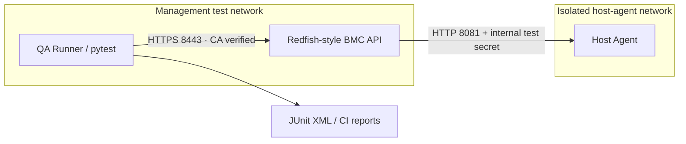

# Host Management Network QA Lab

[](https://github.com/mohamedtah22/embedded-systems-runtime/actions/workflows/host-management-qa-lab.yml)

**End-to-end Software QA testbed using Python, Linux, HTTPS/TLS, pytest, Docker Compose, and Redfish-inspired host management APIs.** Built to demonstrate reproducible functional, regression, security, performance-smoke and topology tests in a realistic *simulated* management network.

> **Scope disclaimer:** This is **not real BMC hardware**, production Redfish firmware, IPMI, NVIDIA networking equipment, or a compliance/security certification. The API implements a small **Redfish-inspired** subset; IP and VLAN changes update a test model only. Docker networks demonstrate container connectivity/isolation, not physical switching.

## What is included

- **BMC simulator** — a TLS-only (TLS >= 1.2) management API with a service root, Manager metadata, host power state and reset actions, management NIC IPv4/VLAN settings and audit EventLog.
- **Host Agent** — separate service with host power/boot state; the BMC reaches it over a *different* network connection using an internal secret.
- **QA automation framework** — Python `pytest` drives real HTTPS requests, checks status codes, security controls, end-to-end state changes and errors, and emits JUnit XML.
- **Test topology** — Docker Compose `qa-runner -> mgmt_net -> bmc -> host_net -> host-agent`. The runner cannot resolve or directly reach the host agent.
- **Security** — CA-verified TLS, Admin/Viewer bearer-token role checks, malformed request rejection and an internal-agent access boundary. Test-only credentials, never production credentials.
- **Documentation** — formal test-case matrix and traceability, manual test procedures, example defect reproduction and CI reports.

## Architecture



**Network isolation:** the QA runner attaches only to `mgmt_net`; the host agent attaches only to `host_net`; the BMC bridges the two networks *at the application layer* (not L2 switching). The test suite checks isolation via container DNS.

## Run on Linux (no Docker, no sudo)

Requires Python 3.10+, `pytest`, and OpenSSL. The tests start real HTTPS BMC and internal host-agent services on **ephemeral loopback ports**, generate a fresh test certificate and verify it, then tear down the services.

```bash
cd projects/host-management-qa-lab
python3 -m venv .venv
source .venv/bin/activate
pip install -r requirements-dev.txt
make test
```

Local suite: **51 passed, 1 Docker-only topology test skipped** at initial verification. CI re-runs the suite for published commits; see the badge for current results. A local output file `reports/junit.xml` records the individual test outcomes.

## Interactive manual QA demo

```bash
cd projects/host-management-qa-lab
sh scripts/run_local_lab.sh
# In a second terminal, from the same folder:
export BMC_ADMIN_TOKEN="local-admin-demo-token-2026"
export BMC_VIEWER_TOKEN="local-viewer-demo-token-2026"
curl --cacert certs/cert.pem -H "Authorization: Bearer $BMC_VIEWER_TOKEN" \
  https://localhost:8443/redfish/v1
```

Credentials above are **disposable lab-only tokens**. See [`docs/TEST_PLAN.md`](docs/TEST_PLAN.md) for manual negative and security test cases.

## Run real multi-container topology

Requires Docker Compose v2. The Compose lab creates two isolated *container networks* and runs the QA service on the management side. It generates a short-lived self-signed test cert at runtime into a shared test volume (not committed).

```bash
cd projects/host-management-qa-lab
sh scripts/compose_test.sh
```

The Docker suite should run all tests, including the management-to-host isolation assertion. The image does **not** expose test ports to the public host. The automated workflow runs this separately from loopback tests.

### Useful diagnostic commands

```bash
docker compose ps
docker compose logs --no-color bmc host-agent
docker compose run --rm qa-runner getent hosts bmc
# Host agent is intentionally not resolvable from the QA management network:
docker compose run --rm qa-runner getent hosts host-agent
```

## Relevant API behavior

| Method | Resource | Expected purpose |
|---|---|---|
| GET | `/redfish/v1` | Service discovery |
| GET | `/redfish/v1/Managers/BMC` | Management metadata / generation |
| GET | `/redfish/v1/Systems/Host` | Host power and boot counter via agent |
| POST | `/redfish/v1/Systems/Host/Actions/ComputerSystem.Reset` | `On`, `ForceOff`, `ForceRestart` |
| POST | `/redfish/v1/Managers/BMC/Actions/Manager.Reset` | `GracefulRestart` (in-memory simulation) |
| GET/PATCH | `/redfish/v1/Managers/BMC/EthernetInterfaces/eth0` | Validate IPv4, subnet, gateway and VLAN |
| GET | `/redfish/v1/Systems/Host/LogServices/EventLog/Entries` | Event audit history |

Security policy: all endpoints require a valid Bearer token; GET allows Viewer or Admin; writes require Admin. Unknown resources return JSON 404. The `/_lab/reset` endpoint exists **only to reset teaching fixtures for independent tests**, not as a Redfish endpoint.

## Engineering evidence

- Functional: host power transitions, management service reset, log ordering, management IP/VLAN setting.
- Negative: invalid VLAN, gateway/subnet mismatch, invalid/reset types, wrong Content-Type, invalid JSON, unknown resources.
- Security: bad/missing token, Viewer write attempts, TLS certificate/hostname verification, rejection of direct host-agent requests.
- Concurrency and performance smoke: 32 concurrent management reads and 20 sequential TLS reads. These are CI safety checks, **not load-test or NIC hardware performance benchmarks**.
- Traceable test matrix, manual instructions and bug-report template in [`docs/TEST_PLAN.md`](docs/TEST_PLAN.md).
- Example reproducible defect report in [`docs/DEFECT_EXAMPLE.md`](docs/DEFECT_EXAMPLE.md) (explicitly hypothetical).

## File layout

```text
src/bmc.py                 TLS-only Redfish-inspired API, auth and network validation
src/host_agent.py          Internal host state / power management simulator
src/client.py              CA-verifying management QA client
tests/conftest.py          Real subprocess lifecycle, test fixtures and isolation
tests/test_functional.py  Functional, negative and boundary tests
tests/test_security.py    Authentication, authorization and TLS regression
tests/test_integration.py Concurrent management, performance and topology tests
compose.yaml               Two-network testbed with 3 containers
Dockerfile                 Reproducible tester/service image
scripts/gen_dev_cert.sh    Generates disposable certs at test runtime
scripts/run_local_lab.sh    Interactive two-process demonstration
scripts/compose_test.sh    Runs Compose suite and cleans resources
docs/TEST_PLAN.md          Requirements coverage + test cases + manual QA
docs/DEFECT_EXAMPLE.md     Reproducible hypothetical bug report
```

## Ideas for follow-up work

1. Replace the mock BMC with a read-only, standards-aware Redfish API client against a physical test server with authorization.
2. Add explicit packet capture and controlled `tc netem` scenarios in an isolated privileged lab, never in normal CI.
3. Extend performance measurements to capture distributions and confidence intervals rather than a single coarse smoke threshold.
4. Use vault-managed secrets and proper trusted PKI in any environment beyond this *local-only* demo.

## License

MIT — educational project, not affiliated with NVIDIA.
